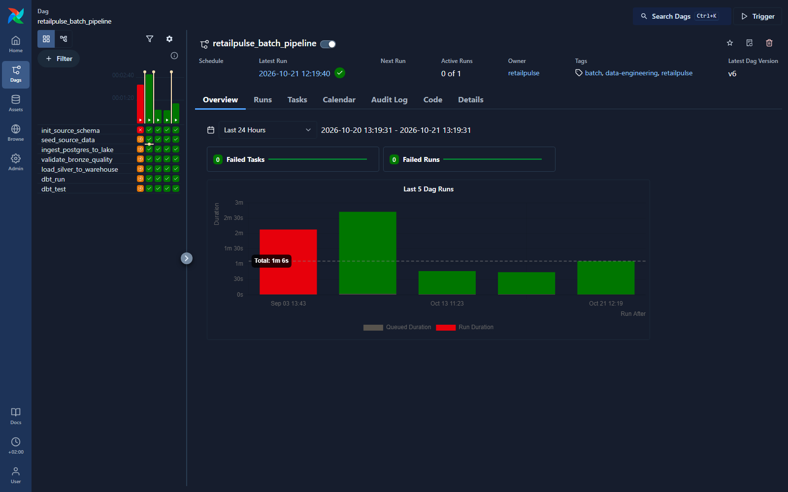
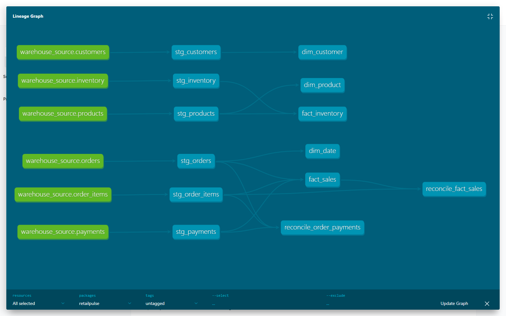

# RetailPulse — E-commerce Data Engineering Platform


[Versión en español](README.md)

Data Engineering portfolio project with an end-to-end e-commerce batch pipeline and a first Kafka-based web-event vertical.

The focus is on building reproducible, traceable and technically solid local workflows rather than replicating a production-scale platform.

## Problem simulated

An e-commerce company has operational data spread across customers, products, inventory, orders, order items and payments. Before it can be analyzed, that data needs to be extracted, stored in layers, validated, loaded into a warehouse and transformed into useful analytical models.

RetailPulse reproduces that process with controlled relational synthetic data.

## Current status

Stable v1.0 batch pipeline. Streaming v2.0 in development.

Included:

- synthetic e-commerce data generation.
- PostgreSQL operational source.
- local data lake with `raw`, `bronze`, `silver`, `rejected` and `audit` layers.
- Python ingestion from PostgreSQL.
- data quality validation with rejected records.
- deterministic bad-data demo mode.
- `silver` loading into PostgreSQL `warehouse_source`.
- dbt staging and mart models.
- dbt tests for keys, accepted values and relationships.
- optional local Airflow orchestration.
- Python producer and consumer for web events through a local three-broker Kafka cluster.
- raw JSONL event storage with topic, partition, offset, timestamp and key.
- raw-to-bronze Parquet event conversion with ingestion metadata.
- bronze event validation with silver, rejected and audit outputs.
- unit tests and a reduced real-PostgreSQL and dbt run in GitHub Actions.

v1.0 covers the complete batch pipeline up to the dbt marts. v2.0 adds an independent Kafka flow that currently reaches silver/rejected storage.

## Architecture

```text
Batch:     PostgreSQL → Python → raw/bronze → quality → silver → warehouse → dbt
Streaming: web events → Kafka → Python consumer → raw → bronze → quality → silver/rejected
```

Airflow does not transform data. It only coordinates existing Python and dbt commands.

More detail: [`docs/architecture.md`](docs/architecture.md).

## Visual evidence

### Airflow orchestration



### dbt model lineage



## Stack

- Python
- pandas
- PostgreSQL
- SQLAlchemy
- Parquet / pyarrow
- dbt-postgres
- local Apache Airflow
- local Apache Kafka
- Docker Compose
- pytest
- GitHub Actions
- SQL

## What this project demonstrates

- Layered batch pipeline design with execution traceability.
- Clear separation between ingestion, quality, modeling and orchestration.
- Explicit handling of valid, rejected and audit outputs.
- Dimensional modeling with facts and dimensions built from previously validated data.
- Controlled reruns and practical idempotency through partitions and replace-based loads.
- Use of tests and documentation to define technical and analytical contracts.

## Quick execution

Requires Python 3.11. Prepare the environment:

```bash
cp .env.example .env
pip install -r requirements.txt
cp dbt/profiles.yml.example dbt/profiles.yml
```

PowerShell:

```powershell
Copy-Item .env.example .env
python -m pip install -r requirements.txt
Copy-Item dbt/profiles.yml.example dbt/profiles.yml
```

Start PostgreSQL and run the manual flow:

```bash
make up
make init-db
make seed-db
make ingest-lake LOAD_DATE=YYYY-MM-DD
make quality LOAD_DATE=YYYY-MM-DD
make load-warehouse LOAD_DATE=YYYY-MM-DD
make dbt-run
make dbt-test
```

Run a finite streaming demo:

The PostgreSQL source must be running, initialized and seeded because the producer uses real IDs from `customers` and `products`. The topic uses three partitions, replication factor three and distributes sessions through `session_id`.

```bash
make up
make init-db
make seed-db
make kafka-up
make produce-events EVENT_COUNT=20 EVENT_SEED=42
make consume-events EVENT_COUNT=20
make bronze-events EVENT_DATE=2026-01-01
make quality-events EVENT_DATE=2026-01-01
make kafka-down
```

To demonstrate rejected records without changing the normal run: `make quality-events-demo EVENT_DATE=2026-01-01 EVENT_RUN_ID=<source_run_id>`.

More detail: [`docs/streaming.md`](docs/streaming.md).

All three targets accept `LOAD_DATE`; if omitted, they use the current UTC date. The Python modules also accept `--load-date`.

## Airflow execution

Airflow is optional and intended for local development.

```bash
make airflow-up
make airflow-ps
make airflow-logs
```

Open:

```text
http://localhost:8080
```

Manually trigger the DAG:

```text
retailpulse_batch_pipeline
```

Optional configuration:

```json
{
  "load_date": "YYYY-MM-DD"
}
```

Stop Airflow:

```bash
make airflow-down
```

More detail: [`docs/orchestration.md`](docs/orchestration.md).

## Data quality and rejected records

Quality validation reads `bronze`, applies completeness, uniqueness, domain, amount and foreign-key checks, and separates:

```text
bronze
    ├── silver   → warehouse → dbt → marts
    ├── rejected → diagnosis / audit / possible reprocessing
    └── audit    → summary by table and run
```

Rejected records keep the original columns and add:

- `quality_run_id`
- `quality_checked_at`
- `rejection_reason`

Rejected records do not feed marts to avoid contaminating business metrics.

More detail: [`docs/data_quality.md`](docs/data_quality.md).

## Quality demo

Because the normal synthetic source is consistent, a run can produce zero rejected records. That is expected.

To demonstrate the rejection path in a controlled way:

```bash
make quality-demo SOURCE_LOAD_DATE=YYYY-MM-DD
```

By default, it creates and validates a demo partition dated `2099-01-01`.

## Analytical model

dbt builds:

Staging:

- `stg_customers`
- `stg_products`
- `stg_inventory`
- `stg_orders`
- `stg_order_items`
- `stg_payments`

Marts:

- `dim_customer`
- `dim_product`
- `dim_date`
- `fact_sales`
- `fact_inventory`

`fact_sales` is at order-item grain (`order_item_id`). `fact_inventory` is at product grain (`product_id`).

More detail: [`docs/warehouse_model.md`](docs/warehouse_model.md).

## Repository structure

```text
.
├── dags/                         # Airflow DAG
├── data/                         # Local lake layers, generated data ignored by Git
├── dbt/                          # dbt project
├── docs/                         # Technical documentation
├── sql/                          # Source and warehouse schema SQL
├── src/
│   ├── ingest/                   # PostgreSQL → lake ingestion
│   ├── streaming/                # Kafka event model, producer and consumer
│   ├── quality/                  # Quality, rejected records and demo
│   ├── synthetic_data/           # Synthetic generation
│   ├── utils/                    # Config, paths and database helpers
│   └── warehouse/                # Silver → warehouse loading
├── tests/                        # Unit and integration tests
├── docker-compose.yml            # Selectable PostgreSQL, Airflow and Kafka services
├── Dockerfile.airflow
├── constraints.txt               # Exact resolution tested on Python 3.11
├── Makefile
└── requirements.txt
```

## Technical documentation

- [`docs/architecture.md`](docs/architecture.md)
- [`docs/source_model.md`](docs/source_model.md)
- [`docs/ingestion.md`](docs/ingestion.md)
- [`docs/data_quality.md`](docs/data_quality.md)
- [`docs/data_dictionary.md`](docs/data_dictionary.md)
- [`docs/idempotency.md`](docs/idempotency.md)
- [`docs/warehouse_model.md`](docs/warehouse_model.md)
- [`docs/limitations.md`](docs/limitations.md)
- [`docs/orchestration.md`](docs/orchestration.md)
- [`docs/streaming.md`](docs/streaming.md)
- [`docs/runbook.md`](docs/runbook.md)
- [`docs/technical_decisions.md`](docs/technical_decisions.md)

## Development note

This project was developed with support from Codex as a programming and learning assistant. It was used to compare technical decisions, debug issues, review alternatives, and speed up implementation and documentation tasks.

The pipeline architecture, project scope, result validation, final decisions, and code review were worked through deliberately during development.

## Limitations

- The data is synthetic.
- The batch pipeline and first streaming vertical are local.
- Kafka uses three brokers to demonstrate local replication and failover, without claiming production operations.
- The warehouse load uses full refresh / replace.
- There is no incremental loading.
- There is no dashboard in v1.0.
- Airflow is local/dev only.
- There are no SCDs or semantic metrics layer.
- CI tests streaming code without a broker and runs a reduced batch pipeline with real PostgreSQL and dbt; Kafka and Airflow are validated separately in local development.
- Rejected records are kept in the lake, not analytical marts.

## Reasonable next steps

1. Build a simple dashboard on top of the dbt marts.
2. Add business-oriented metrics for analytical consumption.
3. Explore an incremental loading strategy.
4. Add operational checks around freshness and volume.
5. Evaluate additional extensions only when they solve a concrete project problem.
