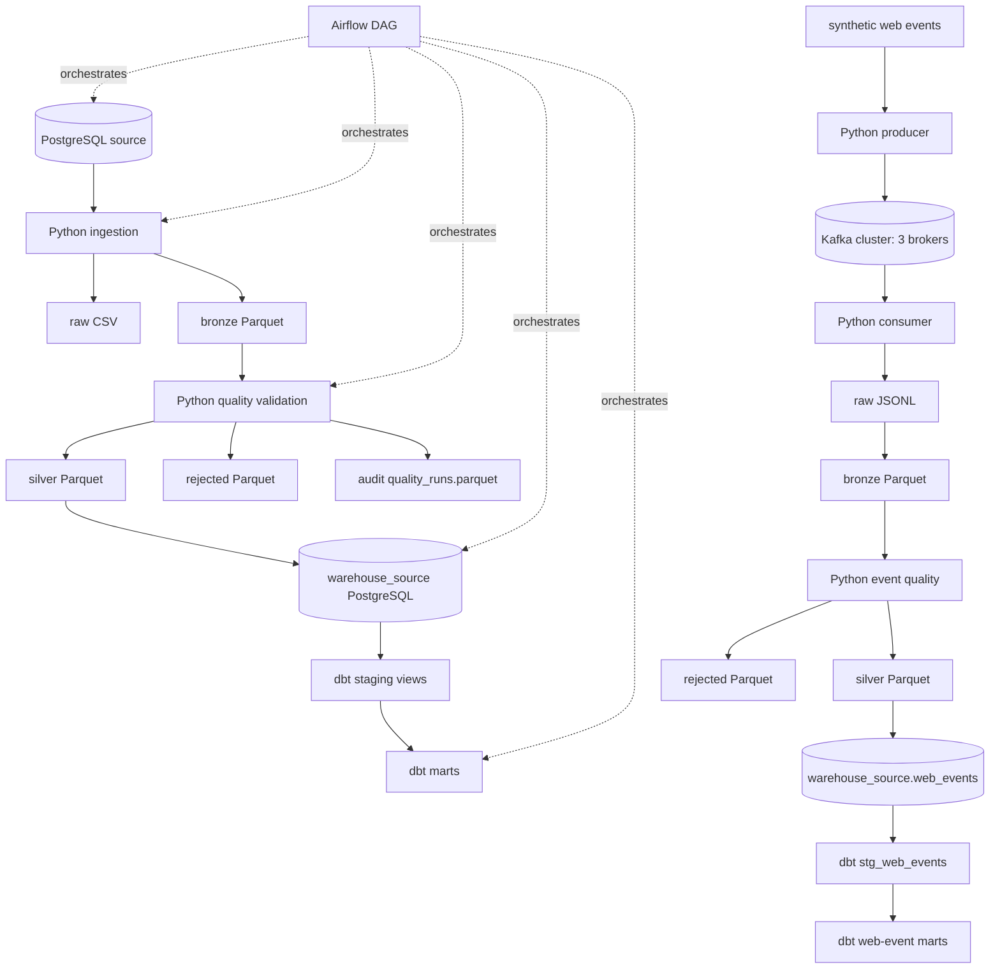

# Architecture / Arquitectura

## ES — Objetivo de la arquitectura

RetailPulse mantiene el pipeline batch local cerrado en v1.0 y añade en v2.0 un segundo flujo local para eventos web. Ambos flujos comparten el data lake raw, pero Kafka no sustituye PostgreSQL ni cambia el recorrido batch.

El diseño prioriza la separación de responsabilidades y la trazabilidad entre capas, manteniendo una función clara para cada componente.

## ES — Flujo general



Versión textual:

```text
PostgreSQL source -> Python ingestion
  ├── raw CSV
  └── bronze Parquet -> quality validation
                         ├── silver -> warehouse_source -> dbt staging -> dbt marts
                         ├── rejected
                         └── audit

Airflow: orchestration of existing steps
Streaming: web events -> Kafka -> Python consumer -> raw -> bronze -> quality
                                                      ├── silver -> warehouse_source.web_events -> dbt
                                                      └── rejected + audit
Dashboard: outside v1.0
```

## ES — Componentes principales

### 1. Fuente PostgreSQL

PostgreSQL simula el sistema operacional del e-commerce.

Tablas fuente:

- `customers`
- `products`
- `inventory`
- `orders`
- `order_items`
- `payments`

La fuente es sintética, pero mantiene relaciones y restricciones para representar un sistema transaccional controlado.

### 2. Ingesta Python

Python extrae las tablas fuente desde PostgreSQL y escribe snapshots locales.

Raw y bronze se escriben desde el mismo DataFrame extraído; bronze no se construye releyendo el CSV raw. Las flechas discontinuas del diagrama representan coordinación de Airflow, no transferencia de datos.

Responsabilidades:

- conectarse a PostgreSQL.
- extraer tablas fuente.
- escribir raw y bronze.
- añadir metadatos de ingesta.
- exponer comandos CLI reproducibles.

### 3. Raw

`raw` guarda snapshots CSV sin transformar.

Su objetivo es conservar una copia simple e inspeccionable de lo extraído. No es la capa analítica principal.

### 4. Bronze

`bronze` guarda Parquet con metadatos técnicos:

- `ingestion_id`
- `ingested_at`
- `source_system`
- `source_table`

Bronze todavía no se considera dato aprobado para analítica.

### 5. Validación de calidad

La validación lee bronze, aplica reglas deterministas y separa registros válidos e inválidos.

Comprueba completitud, unicidad, dominios permitidos, importes y claves foráneas simples.

### 6. Silver

`silver` contiene solo registros que superan las reglas de calidad.

Es la única entrada del warehouse analítico tanto para tablas batch como para eventos.

### 7. Rejected

`rejected` conserva registros inválidos con `rejection_reason`.

No alimenta marts porque podría contaminar métricas de negocio. Su uso es diagnóstico, auditoría y posible reproceso.

### 8. Audit

`data/audit/quality_runs.parquet` resume cada validación con conteos de entrada, válidos, rechazados y estado por tabla.

### 9. Warehouse source

`warehouse_source` expone en PostgreSQL las seis tablas batch silver y `web_events` para dbt.

Las tablas batch usan full refresh / replace. `web_events` usa append transaccional con `event_id` como clave de conflicto, por lo que repetir el mismo `run_id` no duplica eventos.

### 10. dbt staging

Los modelos `stg_*` seleccionan columnas explícitas, castean tipos y conservan metadatos. No hacen joins ni agregaciones.

### 11. dbt marts

Los marts iniciales son:

- `dim_customer`
- `dim_product`
- `dim_date`
- `fact_sales`
- `fact_inventory`
- `fact_web_events`
- `fact_web_sessions`

`fact_sales` tiene grano de línea de pedido, `fact_inventory` de producto, `fact_web_events` de evento y `fact_web_sessions` de sesión.

### 12. Airflow

Airflow orquesta el flujo completo con un DAG manual local. No contiene lógica de transformación ni reglas de negocio.

### 13. Streaming Kafka v2.0

Un producer Python usa clientes y productos existentes en PostgreSQL para publicar eventos web sintéticos en las tres particiones de `retailpulse.web_events`, usando `session_id` como message key. Cada sesión conserva un único cliente o permanece anónima. Uno o varios consumers del mismo grupo pueden repartirse las particiones y conservan el payload y los metadatos `topic`, `partition`, `offset`, `timestamp` y `key` en raw JSONL. Un paso posterior aplana cada sobre raw y escribe un Parquet bronze por `run_id`, conservando la trazabilidad al fichero de origen. La validación separa eventos silver y rejected, con auditoría por `run_id`. Solo silver aprobado se añade de forma idempotente a `warehouse_source.web_events`; dbt lo transforma en hechos de evento y sesión.

Esta vertical usa tres nodos combinados KRaft, tres particiones, factor de replicación tres y mínimo de dos réplicas sincronizadas. Permite demostrar distribución, consumer groups, failover, capas lake, calidad, carga incremental y modelado dbt, pero todavía no está orquestada por Airflow.

## ES — Por qué rejected no entra al warehouse analítico

El warehouse debe modelar datos aprobados. Los registros rechazados pueden contener emails inválidos, precios negativos, estados desconocidos, claves foráneas rotas o totales inconsistentes.

Por eso el flujo es:

```text
silver   -> warehouse_source -> dbt -> marts
rejected -> diagnóstico / auditoría / posible reproceso
```

## ES — Fuera de v1.0

La v1.0 no incluye dashboard, cargas incrementales ni despliegue productivo. Otras extensiones tecnológicas se evaluarán por separado si aportan valor al proyecto.

---

## EN — Architecture objective

RetailPulse keeps the local v1.0 batch pipeline stable and adds a second local web-event flow in v2.0. Both flows use local raw storage, but Kafka does not replace PostgreSQL or change the batch path.

The design prioritizes separation of responsibilities and traceability across layers, keeping a clear purpose for each component.

## EN — General flow


Text version:

```text
PostgreSQL source -> Python ingestion
  ├── raw CSV
  └── bronze Parquet -> quality validation
                         ├── silver -> warehouse_source -> dbt staging -> dbt marts
                         ├── rejected
                         └── audit

Airflow: orchestration of existing steps
Streaming: web events -> Kafka -> Python consumer -> raw -> bronze -> quality
                                                      ├── silver -> warehouse_source.web_events -> dbt
                                                      └── rejected + audit
Dashboard: outside v1.0
```

## EN — Main components

### 1. PostgreSQL source

PostgreSQL simulates the e-commerce operational system.

Source tables:

- `customers`
- `products`
- `inventory`
- `orders`
- `order_items`
- `payments`

The source is synthetic, but it keeps relationships and constraints to represent a controlled transactional system.

### 2. Python ingestion

Python extracts source tables from PostgreSQL and writes local snapshots.

Raw and bronze are written from the same extracted DataFrame; bronze is not built by rereading the raw CSV. Dashed arrows represent Airflow coordination, not data transfer.

Responsibilities:

- connect to PostgreSQL.
- extract source tables.
- write raw and bronze.
- add ingestion metadata.
- expose reproducible CLI commands.

### 3. Raw

`raw` stores untransformed CSV snapshots.

Its purpose is to keep a simple inspectable copy of what was extracted. It is not the main analytical layer.

### 4. Bronze

`bronze` stores Parquet files with technical metadata:

- `ingestion_id`
- `ingested_at`
- `source_system`
- `source_table`

Bronze is still not trusted for analytics.

### 5. Quality validation

Quality validation reads bronze, applies deterministic rules and separates valid and invalid records.

It checks completeness, uniqueness, accepted domains, amounts and simple foreign keys.

### 6. Silver

`silver` contains only records that passed all quality checks.

It is the only input to the analytical warehouse for both batch tables and events.

### 7. Rejected

`rejected` keeps invalid records with `rejection_reason`.

It does not feed marts because it could contaminate business metrics. Its purpose is diagnosis, audit and possible reprocessing.

### 8. Audit

`data/audit/quality_runs.parquet` summarizes each validation with input, valid, rejected and status counts by table.

### 9. Warehouse source

`warehouse_source` exposes the six batch silver tables and `web_events` in PostgreSQL for dbt.

Batch tables use full refresh / replace. `web_events` uses transactional append with `event_id` as the conflict key, so loading the same `run_id` again does not duplicate events.

### 10. dbt staging

`stg_*` models select explicit columns, cast types and preserve metadata. They do not join or aggregate.

### 11. dbt marts

Initial marts:

- `dim_customer`
- `dim_product`
- `dim_date`
- `fact_sales`
- `fact_inventory`
- `fact_web_events`
- `fact_web_sessions`

`fact_sales` is at order-item grain, `fact_inventory` at product grain, `fact_web_events` at event grain and `fact_web_sessions` at session grain.

### 12. Airflow

Airflow orchestrates the full flow with a local manual DAG. It does not contain transformation logic or business rules.

### 13. Kafka streaming v2.0

A Python producer uses existing PostgreSQL customers and products to publish synthetic web events across the three partitions of `retailpulse.web_events`, with `session_id` as the message key. Each session keeps one customer or remains anonymous. One or more consumers in the same group can divide the partitions and preserve the payload and the `topic`, `partition`, `offset`, `timestamp` and `key` metadata in raw JSONL. A later step flattens each raw envelope and writes one bronze Parquet file per `run_id`, preserving traceability to the source file. Validation separates silver and rejected events, with audit records per `run_id`. Only approved silver is appended idempotently to `warehouse_source.web_events`; dbt transforms it into event and session facts.

This vertical uses three combined KRaft nodes, three partitions, replication factor three and a minimum of two in-sync replicas. It demonstrates distribution, consumer groups, failover, lake layers, quality, incremental loading and dbt modeling, but is not yet orchestrated by Airflow.

## EN — Why rejected does not enter the analytical warehouse

The warehouse should model approved data. Rejected records can contain invalid emails, negative prices, unknown statuses, broken foreign keys or inconsistent totals.

Therefore, the flow is:

```text
silver   -> warehouse_source -> dbt -> marts
rejected -> diagnosis / audit / possible reprocessing
```

## EN — Outside v1.0

v1.0 does not include a dashboard, incremental loading or production deployment. Other technology extensions will be evaluated separately if they add value to the project.
